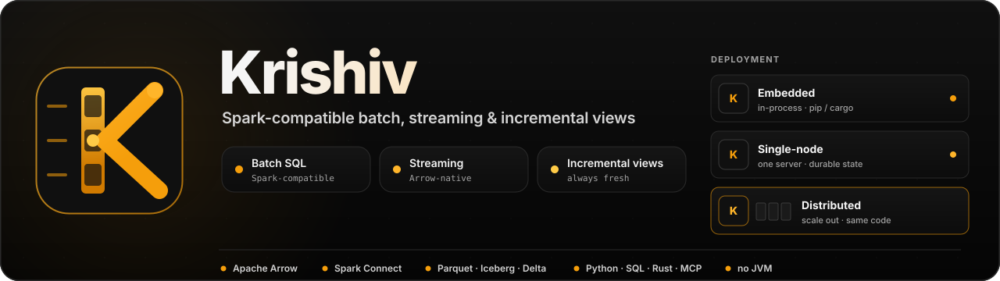

<p align="center">
  <a href="https://krishiv.ai">
    
  </a>
</p>

<p align="center">
  <a href="https://github.com/KrishivAI/krishiv-engine/actions/workflows/ci.yml"></a>
  <a href="LICENSE"></a>
  
  
  <a href="https://scorecard.dev/viewer/?uri=github.com/KrishivAI/krishiv-engine"></a>
  <a href="https://codspeed.io/KrishivAI/krishiv-engine"></a>
  <a href="https://codecov.io/gh/KrishivAI/krishiv-engine"></a>
  <a href="https://krishiv.ai"></a>
</p>

<p align="center">
  <a href="https://github.com/KrishivAI/krishiv-engine/stargazers"></a>
  <a href="https://github.com/KrishivAI/krishiv-engine/watchers"></a>
  <a href="https://github.com/KrishivAI"></a>
</p>

<h3 align="center">Your Spark code. No JVM. One engine for batch, streaming and always-fresh views.</h3>

**Krishiv** is a Rust-native, Spark-compatible compute engine we are building for the agentic era. Keep the PySpark
and Spark SQL you already write, and run it on a vectorized, Arrow-native engine that handles **batch SQL**,
**streaming** and **incrementally maintained materialized views** with the same semantics. Start in-process on a
laptop, and take the same code to a single server or a cluster.

> [!WARNING]
> **Alpha (`0.1.0-alpha`): the embedded core runs, the rest is being built.** You can run SQL and DataFrames
> in-process from Python today (see the [Quickstart](#quickstart)); there is no stable API yet, and nothing has been
> published to PyPI or crates.io. The sections after the Quickstart describe what we are building, not what exists
> today.

<p align="center">
  <b>⭐ Star the repo and 👀 Watch → Custom → Releases to follow development from the first commit to 1.0.</b>
</p>

## Why Krishiv

| | Design goal | What it means for you |
|---|---|---|
| 🦀 | **Spark-compatible, no JVM** | Keep your PySpark and Spark SQL code. Spark Connect clients connect directly; execution is Rust-native and vectorized. |
| 🔁 | **One engine: batch, streaming, incremental** | The same SQL and the same semantics everywhere. A batch query is just a bounded stream. |
| 📦 | **Embedded → single-node → distributed** | `pip install krishiv` or `cargo add krishiv` to start in-process, then scale out without rewriting your code. |
| ⚡ | **Always-fresh materialized views** | Views update incrementally as data changes (DBSP-inspired incremental computation), and streaming state is directly queryable. |
| 🤖 | **Built for the agentic era** | A built-in MCP server lets AI agents explore and query your data; Arrow-native, zero-copy interop with pandas, Polars and PyArrow. |
| ✅ | **Open and correctness-first** | Apache-2.0. Tested against real Spark behaviour with golden fixtures and differential testing. |

## How it fits

```mermaid
flowchart LR
    subgraph APIs["Your code"]
        A1["PySpark via Spark Connect"]
        A2["SQL"]
        A3["Python DataFrames"]
        A4["Rust"]
        A5["MCP for AI agents"]
        A6["Arrow Flight SQL"]
    end
    subgraph Engine["One Krishiv engine"]
        E1["Batch"]
        E2["Streaming"]
        E3["Incremental views"]
    end
    subgraph Deploy["Run it anywhere"]
        D1["Embedded"]
        D2["Single-node"]
        D3["Distributed"]
    end
    subgraph Lake["Your lakehouse"]
        L1["Parquet"]
        L2["Apache Iceberg"]
        L3["Delta Lake"]
    end
    APIs --> Engine --> Deploy --> Lake
```



## Supported CPUs

The shipped x86-64 binaries and wheels are built for the **x86-64-v3** level: AVX, AVX2, FMA, BMI1/2, F16C, LZCNT and
MOVBE, i.e. Intel Haswell (2013) / AMD Excavator and Zen or newer. The arm64 builds target an Armv8.2 baseline
(`neoverse-n1`: AWS Graviton2 or newer, Apple silicon). On an older CPU the main build refuses to start and says
which feature is missing, instead of crashing (the Python package raises an `ImportError`; on Linux only: the
macOS arm64 and Windows wheels are separate builds and are not checked).

For an older x86-64 CPU use the **compat** build, which targets the plain x86-64 baseline (a little slower on
vectorised workloads). It covers Linux x86-64 only: a manylinux x86_64 wheel and an x86-64 CLI binary. No arm64 or
musllinux compat build is provided:

- Python: `pip install krishiv-compat` (it is the same package and imports as `krishiv`; install one of the two, not both).
- CLI: download the `krishiv-compat` binary from the release.

## Status and roadmap at a glance

Krishiv is at **`0.1.0-alpha`**. The embedded core (in-process batch SQL and DataFrames over Arrow, from Python) runs;
streaming, incremental views, Spark Connect and distributed execution are still being built.

| Milestone | Focus | Status |
|---|---|---|
| 1. Embedded core alpha | In-process SQL and DataFrames on Arrow, with Python and Rust APIs | 🚧 In progress |
| 2. Spark Connect and lakehouse | PySpark over Spark Connect; Parquet, Iceberg and Delta | ⏳ Planned |
| 3. Streaming | Stateful streaming with the same SQL and semantics as batch | ⏳ Planned |
| 4. Incremental views | Always-fresh materialized views and queryable state | ⏳ Planned |
| 5. Distributed | Scale out to a cluster with the same code | ⏳ Planned |
| 6. 1.0 | Stable APIs and formats | ⏳ Planned |

Watch **Releases** to hear when the first alpha lands.

## Quickstart

The embedded core runs in your process: no server, no JVM. Needs Python 3.11 or newer. Nothing is published yet, so
until the first release is out, build the wheel from this repository (`maturin build`, see
[python/README.md](python/README.md)) and install that file instead of the name below.

<!-- quickstart:begin (CI runs every block below from a clean venv against the built wheel: .github/scripts/quickstart-test.sh) -->

Install, with pyarrow for the Arrow results:

```bash
pip install "krishiv[pyarrow]"
```

SQL and DataFrames:

```python
import tempfile
from pathlib import Path

import pyarrow as pa
import pyarrow.parquet as pq

import krishiv
from krishiv.sql import functions as F

spark = krishiv.session()  # a PySpark-style SparkSession, in process

# SQL.
spark.sql("SELECT 1 AS answer").show()

# DataFrames over a Parquet file; the same file is also a temp view for SQL.
path = str(Path(tempfile.mkdtemp()) / "orders.parquet")
pq.write_table(
    pa.table(
        {
            "region": ["east", "west", "east", "north", "west"],
            "amount": [10.0, 20.0, 5.5, 7.25, 30.0],
        }
    ),
    path,
)
orders = spark.read.parquet(path)
orders.createOrReplaceTempView("orders")

by_region = (
    orders.filter(F.col("amount") > 6)
    .groupBy("region")
    .agg(F.sum("amount").alias("revenue"))
    .orderBy("region")
)
by_region.show()
print(by_region.toArrow())  # a pyarrow.Table; also pa.table(by_region), polars.DataFrame(by_region)

same = spark.sql("SELECT region, sum(amount) AS revenue FROM orders WHERE amount > 6 GROUP BY region ORDER BY region")
assert same.collect() == by_region.collect()
```

`EXPLAIN` and `EXPLAIN ANALYZE` (per-operator rows, time, peak memory and spill bytes):

```python
by_region.explain()  # the physical plan
by_region.explain(analyze=True)  # runs the query and prints each operator's metrics

plan = spark.sql("EXPLAIN ANALYZE SELECT region, sum(amount) FROM orders GROUP BY region").collect()[0][0]
assert plan.startswith("== Physical Plan (analyzed) ==")
```

<!-- quickstart:end -->

Krishiv follows Spark's SQL and DataFrame semantics and error classes; the differences that remain are listed as
they are found. "Spark-compatible" describes that goal and the API shape, not a certification: Krishiv is not Apache
Spark.

## What it will look like

> [!NOTE]
> **Planned API (not yet available).** These snippets show the intended experience and may change.

**Python: your existing PySpark code, pointed at Krishiv over Spark Connect.**

```python
from pyspark.sql import SparkSession, functions as F

# Planned: a local Krishiv server speaking the Spark Connect protocol.
spark = SparkSession.builder.remote("sc://localhost:15002").getOrCreate()

orders = spark.read.parquet("s3://lake/orders/")
daily = orders.groupBy("order_date").agg(F.sum("amount").alias("revenue"))

daily.toPandas()  # results arrive as Arrow
```

**Python: the native Krishiv API — same code, embedded in your process.**

```python
import krishiv
from krishiv.sql import functions as F

# Planned: PySpark-compatible API running in-process — no server, no JVM.
spark = krishiv.SparkSession.builder.getOrCreate()

orders = spark.read.parquet("s3://lake/orders/")
daily = orders.groupBy("order_date").agg(F.sum("amount").alias("revenue"))

daily.to_arrow()   # zero-copy Arrow table (also .to_polars(), .toPandas())
# Same code against a cluster: krishiv.SparkSession.builder.remote("sc://...")
```

**SQL: an always-fresh view over a stream.**

```sql
-- Planned syntax.
CREATE MATERIALIZED VIEW revenue_by_region AS
SELECT region, SUM(amount) AS revenue
FROM orders_stream
GROUP BY region;

-- Reads the latest result, maintained incrementally as events arrive.
SELECT * FROM revenue_by_region ORDER BY revenue DESC;
```

## Follow along and get involved

- ⭐ **Star** the repo and 👀 **Watch → Releases** to get notified about alphas and milestones.
- 🐛 Report bugs or share ideas in [GitHub Issues](https://github.com/KrishivAI/krishiv-engine/issues).
- 🛠️ Read the [contributing guide](CONTRIBUTING.md) for build, test, DCO sign-off and PR rules.
- 🤝 Please follow our [Code of Conduct](CODE_OF_CONDUCT.md).
- 🔒 Report security issues privately as described in [SECURITY.md](SECURITY.md).
- 🌐 Learn more at [krishiv.ai](https://krishiv.ai).

Some code comments reference design records (for example "ADR 0034") that are kept private for now; see
[CONTRIBUTING.md](CONTRIBUTING.md) for what this means for contributors.

## License

Krishiv is licensed under the [Apache License, Version 2.0](LICENSE) (see also [NOTICE](NOTICE)). Contributions
require a DCO sign-off (`git commit -s`).

## Trademarks

Apache Spark, Apache Arrow and Apache Iceberg are trademarks of the Apache Software Foundation. Krishiv is an
independent project and is not affiliated with or endorsed by the Apache Software Foundation.
