<p align="center">
  <a href="https://krishiv.ai">
    
  </a>
</p>

<p align="center">
  <a href="https://github.com/KrishivAI/krishiv-engine/actions/workflows/ci.yml"></a>
  <a href="LICENSE"></a>
  <a href="https://pypi.org/project/krishiv/"></a>
  <a href="https://crates.io/crates/krishiv"></a>
  
  <a href="https://scorecard.dev/viewer/?uri=github.com/KrishivAI/krishiv-engine"></a>
  <a href="https://codspeed.io/KrishivAI/krishiv-engine"></a>
  <a href="https://codecov.io/gh/KrishivAI/krishiv-engine"></a>
  <a href="https://krishiv.ai"></a>
</p>

<p align="center">
  <a href="https://github.com/KrishivAI/krishiv-engine/stargazers"></a>
  <a href="https://github.com/KrishivAI/krishiv-engine/watchers"></a>
  <a href="https://github.com/KrishivAI"></a>
</p>

<h3 align="center">Spark in Rust, no JVM. Your PySpark and Spark SQL, 10× faster on one machine.</h3>

**Krishiv** is an Apache Spark™ alternative written in Rust: run the PySpark and Spark SQL you already write without
the JVM, on a vectorized, Arrow-native engine. It runs in your own process today, and on a server or a cluster as the
next releases land, with one engine for batch, streaming and always-fresh views.

> [!NOTE]
> **Krishiv 0.2 is out** ([release notes](https://github.com/KrishivAI/krishiv-engine/releases/tag/v0.2.0)): the
> embedded core, on [PyPI](https://pypi.org/project/krishiv/) and [crates.io](https://crates.io/crates/krishiv).
> APIs can still change before 1.0.

## Install

**Python** (3.11+, or free-threaded 3.14t):

```bash
pip install "krishiv[pyarrow]"
```

**Rust:**

```bash
cargo add krishiv
```

Install with the `pyarrow` extra: `collect()`, `show()` and `toArrow()` return Arrow data. Wheels cover Linux x86_64
and aarch64 (manylinux and musllinux x86_64) and macOS arm64. For an x86-64 CPU without AVX2 use
`pip install krishiv-compat` ([Supported CPUs](#supported-cpus)).

```python
import krishiv

spark = krishiv.session()  # a PySpark-style SparkSession, in process: no server, no JVM
spark.sql("SELECT 1 AS answer").show()
```

## Benchmarks

**10.4× faster than Apache Spark 4.2.0 on one machine**: geometric mean over 22 queries derived from TPC-H at
scale factor 100, on the same Parquet files and the same laptop.

| | Krishiv 0.2 | Spark 4.2.0 |
|---|---|---|
| SF100, all 22 queries | **228 s** | 2,675 s (3,137 s with 12 shuffle partitions) |
| SF1000 (about 1 TB of Parquet), queries completed | **22 of 22** | 6 of 17 within 30 minutes |

- **Machine:** one laptop, i7-9750H (12 threads), 64 GB RAM, NVMe SSD, Linux.
- **Runs:** cold (the OS page cache is dropped before every run), two runs per query, one engine after another.
- **Limits:** 12 threads and a 20 GB memory limit for Krishiv; Spark 4.2.0 in `local[*]` over Spark Connect,
  `spark.sql.shuffle.partitions=24`, 20g driver, Spark 4 defaults otherwise.
- **Data:** Parquet from `tpchgen` 3.0.0, read in place with no loading step. Krishiv's answers are checked
  (row counts and checksums) against an independent engine at SF10 and SF100.

Reproduce it: the harness is in [`bench/`](bench/README.md). The exact settings of each column (cold runs with
the page cache dropped, 12 threads, a 20 GB engine limit inside a 28 GB scope, Spark 4.2.0 over Spark Connect with
24 shuffle partitions and a 20g driver) and the commands that produced them are in
[bench/README.md, "Spark baseline of the benchmarks page"](bench/README.md#spark-baseline-of-the-benchmarks-page-method).
The harness's defaults are different (32 GB, interleaved warm runs), so use those settings, not the defaults, to
compare with the table.

The harness, engine configurations and method are in [bench/README.md](bench/README.md); every per-query number,
SF10 and SF1000 and the comparison with a reference engine that is still faster today are on
[krishiv.ai/benchmarks](https://krishiv.ai/benchmarks).

<sub>Derived from the TPC-H benchmark. These are not TPC-H results: they are unaudited and not comparable with
published TPC results. TPC-H is a trademark of the Transaction Processing Performance Council.</sub>

## What is in 0.2

- **Embedded Spark-compatible engine.** `krishiv.session()` gives a PySpark-style session in your process, from
  Python or Rust, with no JVM. Spark-observable behaviour is checked against real Spark runs.
- **Memory-bounded and fast.** A vectorized Arrow executor that spills aggregations, joins, sorts and window frames to
  disk instead of failing, with runtime filters, Parquet row-group and dictionary pruning and a cost-based join order.
- **Broad SQL.** Windows (`ROWS`/`RANGE`), `GROUPING SETS`, lateral joins, recursive CTEs, SQL scripting,
  `CHAR`/`VARCHAR`, collations, `VARIANT`, calendar intervals, `GEOMETRY`/`GEOGRAPHY`, `PIVOT`, `TABLESAMPLE`, SQL
  functions and `IDENTIFIER(..)`.
- **Python UDFs in process.** `@udf`, scalar `pandas_udf` and `arrow_udf` run on a thread pool, in parallel on
  free-threaded 3.14t.
- **See what happened.** `EXPLAIN [ANALYZE|COST|VERBOSE]`, a versioned JSON profile with per-scan I/O, a local web
  console, Prometheus metrics, OTLP spans and JSON logs, and errors that point at the SQL span that raised them.
- **Zero-copy interop** with pyarrow, Polars and other Arrow tools through the Arrow PyCapsule interface.
- **`krishiv sql`**, a command-line SQL shell (scripts, table/CSV/JSON output, `--timing`).

The full list is in the [0.2.1 release notes](https://github.com/KrishivAI/krishiv-engine/releases/tag/v0.2.1).

## Status and roadmap at a glance

Krishiv is at **`0.2.1`**. The embedded core (in-process batch SQL and DataFrames over Arrow, from Python) runs;
streaming, incremental views, Spark Connect and distributed execution are still being built.

| Milestone | Focus | Status |
|---|---|---|
| 1. Embedded core alpha | In-process SQL and DataFrames on Arrow, with Python and Rust APIs | 🚧 In progress |
| 2. Single-node (0.3) | `krishiv server` with Spark Connect, authentication, Iceberg and Delta, Python UDFs | ⏳ Planned |
| 3. Streaming | Stateful streaming with the same SQL and semantics as batch | ⏳ Planned |
| 4. Incremental views | Always-fresh materialized views and queryable state | ⏳ Planned |
| 5. Distributed | Scale out to a cluster with the same code | ⏳ Planned |
| 6. 1.0 | Stable APIs and formats | ⏳ Planned |

## Quickstart

The embedded core runs in your process: no server, no JVM. Needs Python 3.11 or newer.

<!-- quickstart:begin (CI runs every block below from a clean venv against the built wheel: .github/scripts/quickstart-test.sh) -->

Install, with pyarrow for the Arrow results:

```bash
pip install "krishiv[pyarrow]"
```

SQL and DataFrames:

```python
import tempfile
from pathlib import Path

import pyarrow as pa
import pyarrow.parquet as pq

import krishiv
from krishiv.sql import functions as F

spark = krishiv.session()  # a PySpark-style SparkSession, in process

# SQL.
spark.sql("SELECT 1 AS answer").show()

# DataFrames over a Parquet file; the same file is also a temp view for SQL.
path = str(Path(tempfile.mkdtemp()) / "orders.parquet")
pq.write_table(
    pa.table(
        {
            "region": ["east", "west", "east", "north", "west"],
            "amount": [10.0, 20.0, 5.5, 7.25, 30.0],
        }
    ),
    path,
)
orders = spark.read.parquet(path)
orders.createOrReplaceTempView("orders")

by_region = (
    orders.filter(F.col("amount") > 6)
    .groupBy("region")
    .agg(F.sum("amount").alias("revenue"))
    .orderBy("region")
)
by_region.show()
print(by_region.toArrow())  # a pyarrow.Table; also pa.table(by_region), polars.DataFrame(by_region)

same = spark.sql("SELECT region, sum(amount) AS revenue FROM orders WHERE amount > 6 GROUP BY region ORDER BY region")
assert same.collect() == by_region.collect()
```

`EXPLAIN` and `EXPLAIN ANALYZE` (per-operator rows, time, peak memory and spill bytes):

```python
by_region.explain()  # the physical plan
by_region.explain(analyze=True)  # runs the query and prints each operator's metrics

plan = spark.sql("EXPLAIN ANALYZE SELECT region, sum(amount) FROM orders GROUP BY region").collect()[0][0]
assert plan.startswith("== Physical Plan (analyzed) ==")
```

<!-- quickstart:end -->

Krishiv follows Spark's SQL and DataFrame semantics and error classes; the differences that remain are listed as
they are found. "Spark-compatible" describes that goal and the API shape, not a certification: Krishiv is not Apache
Spark.

## Why Krishiv

| | Design goal | What it means for you |
|---|---|---|
| 🦀 | **Spark-compatible, no JVM** | Keep your PySpark and Spark SQL code; execution is Rust-native and vectorized. |
| 🔁 | **One engine: batch, streaming, incremental** | The same SQL and the same semantics everywhere. A batch query is just a bounded stream. |
| 📦 | **Embedded → single-node → distributed** | Start in-process with `pip install krishiv`, then scale out without rewriting your code. |
| ⚡ | **Always-fresh materialized views** | Views update incrementally as data changes, and streaming state is directly queryable. |
| 🤖 | **Built for the agentic era** | A built-in MCP server lets AI agents explore and query your data; Arrow-native interop with pandas, Polars and PyArrow. |
| ✅ | **Open and correctness-first** | Apache-2.0. Tested against real Spark behaviour with golden fixtures and differential testing. |

```mermaid
flowchart LR
    subgraph APIs["Your code"]
        A1["PySpark via Spark Connect"]
        A2["SQL"]
        A3["Python DataFrames"]
        A4["Rust"]
        A5["MCP for AI agents"]
        A6["Arrow Flight SQL"]
    end
    subgraph Engine["One Krishiv engine"]
        E1["Batch"]
        E2["Streaming"]
        E3["Incremental views"]
    end
    subgraph Deploy["Run it anywhere"]
        D1["Embedded"]
        D2["Single-node"]
        D3["Distributed"]
    end
    subgraph Lake["Your lakehouse"]
        L1["Parquet"]
        L2["Apache Iceberg"]
        L3["Delta Lake"]
    end
    APIs --> Engine --> Deploy --> Lake
```



## Roadmap

| Release | Focus | Status |
|---|---|---|
| 0.2 | Embedded core: in-process SQL and DataFrames on Arrow, Python and Rust APIs | ✅ Released |
| 0.3 | Spark Connect server, lakehouse tables (Iceberg, Delta), Python UDFs over Connect, authentication | 🚧 In progress |
| Next | Stateful streaming with the same SQL and semantics as batch | ⏳ Planned |
| Next | Always-fresh incremental views and queryable state | ⏳ Planned |
| Next | Distributed execution with the same code | ⏳ Planned |
| 1.0 | Stable APIs and formats | ⏳ Planned |

**Coming in 0.3: your existing PySpark code, pointed at Krishiv over Spark Connect.**

```python
from pyspark.sql import SparkSession, functions as F

# Planned: single-node Krishiv (`krishiv server`) speaking the Spark Connect protocol.
spark = SparkSession.builder.remote("sc://localhost:15002").getOrCreate()

orders = spark.read.parquet("s3://lake/orders/")
daily = orders.groupBy("order_date").agg(F.sum("amount").alias("revenue"))
daily.toPandas()  # results arrive as Arrow
```

## Supported CPUs

The shipped x86-64 binaries and wheels are built for the **x86-64-v3** level: AVX, AVX2, FMA, BMI1/2, F16C, LZCNT and
MOVBE, i.e. Intel Haswell (2013) / AMD Excavator and Zen or newer. The arm64 builds target an Armv8.2 baseline
(`neoverse-n1`: AWS Graviton2 or newer, Apple silicon). On an older CPU the main build refuses to start and says
which feature is missing, instead of crashing (the Python package raises an `ImportError`; on Linux only: the
macOS arm64 and Windows wheels are separate builds and are not checked).

For an older x86-64 CPU use the **compat** build, which targets the plain x86-64 baseline (a little slower on
vectorised workloads). It covers Linux x86-64 only: a manylinux x86_64 wheel and an x86-64 CLI binary. No arm64 or
musllinux compat build is provided:

- Python: `pip install krishiv-compat` (it is the same package and imports as `krishiv`; install one of the two, not both).
- CLI: download the `krishiv-compat` binary from the release.

## Follow along and get involved

- ⭐ **Star** the repo and 👀 **Watch → Custom → Releases** to hear about each release.
- 🐛 Report bugs or share ideas in [GitHub Issues](https://github.com/KrishivAI/krishiv-engine/issues).
- 🛠️ Read the [contributing guide](CONTRIBUTING.md) for build, test, DCO sign-off and PR rules.
- 🤝 Please follow our [Code of Conduct](CODE_OF_CONDUCT.md).
- 🔒 Report security issues privately as described in [SECURITY.md](SECURITY.md).
- 🌐 Learn more at [krishiv.ai](https://krishiv.ai).

Some code comments reference design records (for example "ADR 0034") that are kept private for now; see
[CONTRIBUTING.md](CONTRIBUTING.md) for what this means for contributors.

## License

Krishiv is licensed under the [Apache License, Version 2.0](LICENSE) (see also [NOTICE](NOTICE)). Contributions
require a DCO sign-off (`git commit -s`).

## Trademarks

Apache Spark, Apache Arrow and Apache Iceberg are trademarks of the Apache Software Foundation. Delta Lake is a
trademark of LF Projects, LLC. Krishiv is an independent project and is not affiliated with or endorsed by the Apache
Software Foundation or LF Projects. "Spark-compatible" describes API compatibility with Apache Spark; Krishiv is not
Apache Spark.
